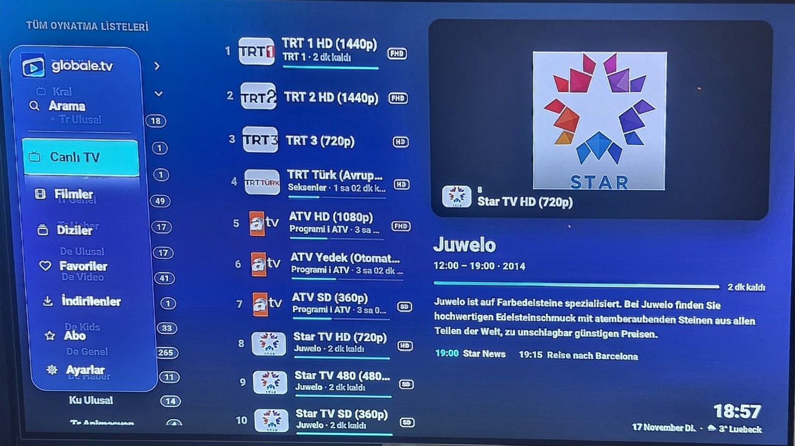
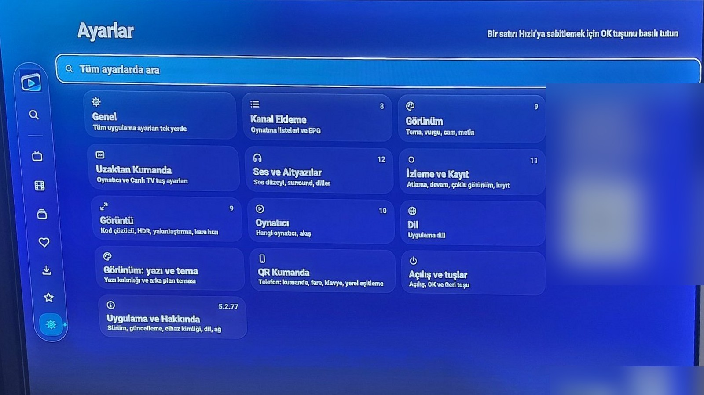

  

<h1 align="center">Globale.tv</h1>

<b>IPTV player for Android TV · Android TV için IPTV oynatıcısı</b>

  <a href="https://github.com/arslanavdo355-sys/Globale.tv-updates/releases/latest/download/Globale.tv.apk"><b>⬇️ Download APK / İndir</b></a>
  ·
  <a href="https://arslanavdo355-sys.github.io/Globale.tv-updates/">Download page / İndirme sayfası</a>
  ·
  <a href="#screenshots--ekran-görüntüleri">Screenshots</a>
  ·
  <a href="#devices--cihazlar">Devices</a>

---

**Globale.tv** is a free, modern media player for **Android TV, Google TV, Fire TV / Fire TV Stick, Android boxes** and (in development) **LG webOS**. Add your own M3U or Xtream playlists and watch live TV, movies and series with a clean, remote-friendly interface. No channels or subscriptions are included.

**Globale.tv**, **Android TV, Google TV, Fire TV / Fire TV Stick, Android kutular** ve (geliştiriliyor) **LG webOS** için ücretsiz, modern bir oynatıcıdır. Kendi M3U veya Xtream listelerini ekle; canlı TV, film ve dizileri kumandayla rahatça izle. Kanal veya abonelik içermez.

## ⬇️ Download / İndir

| | |
|---|---|
| **Most devices / Çoğu cihaz** | **[Globale.tv.apk](https://github.com/arslanavdo355-sys/Globale.tv-updates/releases/latest/download/Globale.tv.apk)** |
| Intel/x86 Android boxes | [Globale.tv-x86_64.apk](https://github.com/arslanavdo355-sys/Globale.tv-updates/releases/latest/download/Globale.tv-x86_64.apk) |
| Simple one-tap page / Sade indirme sayfası | [arslanavdo355-sys.github.io/Globale.tv-updates](https://arslanavdo355-sys.github.io/Globale.tv-updates/) |
| All versions / Tüm sürümler | [Releases](https://github.com/arslanavdo355-sys/Globale.tv-updates/releases) |

## Devices / Cihazlar

| Device / Cihaz | How / Nasıl |
|---|---|
| Android TV, Google TV | Install **Downloader**, enter code **XXXXXXX** or use the link above / **Downloader**'ı kur, **XXXXXXX** kodunu ya da yukarıdaki linki kullan |
| Amazon Fire TV / Fire TV Stick | Install **Downloader** from the Appstore, enter code **XXXXXXX** or use the link above / Appstore'dan **Downloader**'ı kur, **XXXXXXX** kodunu ya da yukarıdaki linki kullan |
| Android phone / box (ARM) | Open the main download link above / Yukarıdaki ana linki aç |
| Android box (Intel/x86) | Open the x86 link above / Yukarıdaki x86 linkini aç |
| LG webOS | In development / Geliştiriliyor |

## Screenshots / Ekran görüntüleri

## Features / Özellikler
- Live TV with EPG, categories, favourites and quality badges (SD / HD / FHD / 4K)
- M3U and Xtream playlists, several playlists in one folder tree
- Preview window, clock and weather on the channel screen
- Movies, series and continue watching
- Theme, text weight and start-up options in Settings
- Six languages: Turkish, English, German, French, Russian, Arabic
- Built for the TV remote

## Roadmap / Yol haritası
- 🔜 **LG webOS** support is planned next / LG webOS desteği sırada, yakında geliyor.

---

Keywords: Globale.tv, IPTV player, M3U player, Xtream player, Android TV, Google TV, Fire TV, Fire TV Stick, webOS, free media player.
